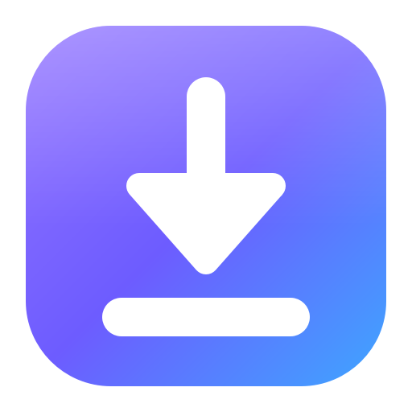
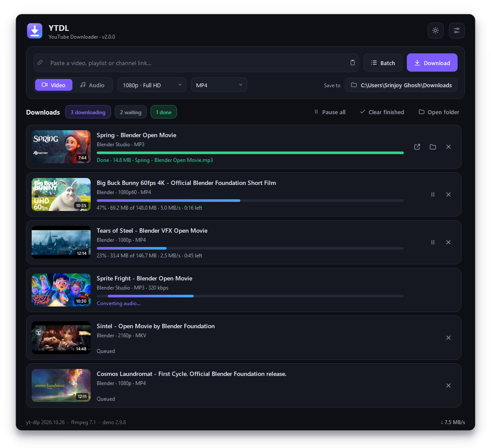
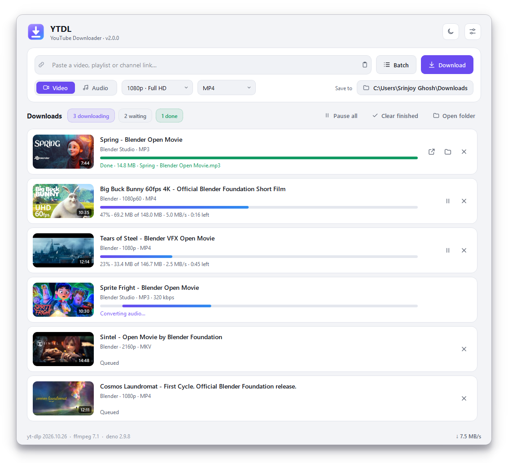
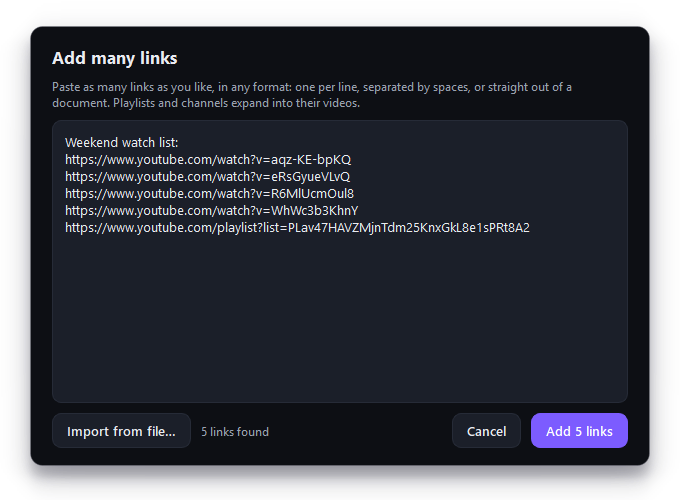
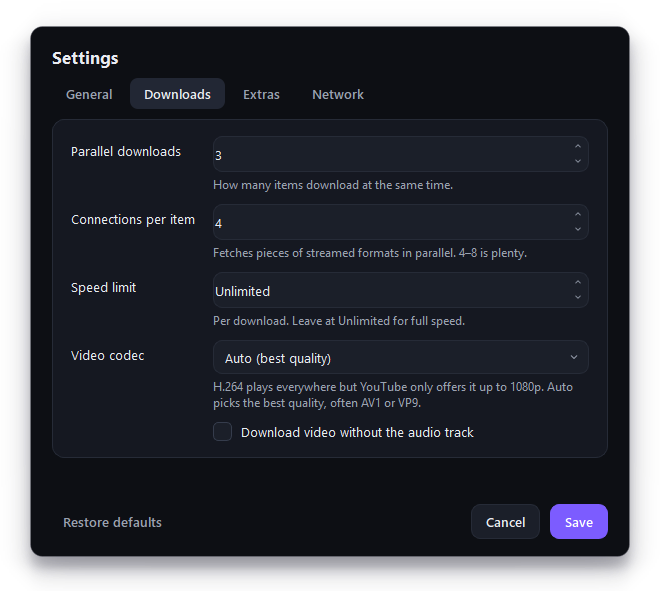

<div align="center">



# YTDL · YouTube Downloader

*“I told my AI to take a break. It downloaded a playlist instead.”*

**A fast, good-looking desktop app for downloading videos, music and whole playlists**<br>
from YouTube and 1000+ other sites. Paste a link, press Download, done.

[](https://github.com/GhoshSrinjoy/youtube-downloader/releases/latest)
[](https://github.com/GhoshSrinjoy/youtube-downloader/releases)
[](https://github.com/GhoshSrinjoy/youtube-downloader/actions/workflows/release.yml)
[](https://github.com/GhoshSrinjoy/youtube-downloader/actions/workflows/ci.yml)
[](LICENSE)
<br>
[](#-download)
[](#-run-from-source)
[](https://www.riverbankcomputing.com/software/pyqt/)
[](https://github.com/yt-dlp/yt-dlp)
[](https://github.com/GhoshSrinjoy/youtube-downloader/stargazers)

<br>

[](https://github.com/GhoshSrinjoy/youtube-downloader/releases/latest/download/YTDL-Windows-x64-Setup.exe)
[](https://github.com/GhoshSrinjoy/youtube-downloader/releases/latest/download/YTDL-macOS-AppleSilicon.dmg)
[](https://github.com/GhoshSrinjoy/youtube-downloader/releases/latest/download/YTDL-macOS-Intel.dmg)
[](https://github.com/GhoshSrinjoy/youtube-downloader/releases/latest/download/YTDL-Linux-x86_64.AppImage)

<sub>Everything is bundled (yt-dlp, FFmpeg, Deno): nothing else to install. Other files and checksums are on the <a href="https://github.com/GhoshSrinjoy/youtube-downloader/releases/latest">releases page</a>.</sub>

<br><br>



</div>

## Why this exists

Command-line downloaders are great, until you hand them to someone who isn't you. Flags are hard to remember,
YouTube keeps changing its formats, and getting `ffmpeg` and friends installed is a chore.

YTDL wraps the excellent [yt-dlp](https://github.com/yt-dlp/yt-dlp) engine in an app you can give to anyone:
download it, double-click, paste a link. Power users still get every knob that matters, plus a command line.

## ✨ Features

- **Paste and go.** Paste a link and press Download (an empty box uses the clipboard), press <kbd>Ctrl</kbd>+<kbd>V</kbd> anywhere, or drop links or a `.txt` file of links onto the window.
- **Batches and playlists.** The Batch dialog takes any number of links in any format. Playlists and channels expand into their videos and land in their own numbered folder.
- **Fast.** Several downloads run at once (1–8), streamed formats are fetched over multiple connections, and the details fetched when a link is added are reused for the download, so each page is extracted once instead of twice. The window opens instantly; yt-dlp loads in the background.
- **Any quality, any format.** Best, 4K, 1440p, 1080p, 720p and down. MP4, MKV or WebM video; MP3, M4A, Opus, FLAC or WAV audio. Prefer H.264 for compatibility or AV1/VP9 for quality.
- **Proper files.** Cover art, title/artist/chapter metadata and subtitles get embedded automatically.
- **A real queue.** Pause, resume (picks up where it stopped), cancel (cleans up partial files), retry, live speed and ETA, and a total speed meter. Right-click an item to copy its link or error.
- **Looks good.** Dark and light themes that follow your system, thumbnails, clear status for every item.
- **Batteries included.** Ships with FFmpeg and Deno (needed to solve YouTube's JavaScript challenges), so it works out of the box.
- **Stays current.** Tells you when a new version (with a newer yt-dlp) is out.
- **Command line too.** The same engine as a CLI, with parallel jobs and batch files.

## 📸 Screenshots



<table>
  <tr>
    <td width="50%" align="center"><br><b>Batch</b>: paste any number of links, or import a text file</td>
    <td width="50%" align="center"><br><b>Settings</b>: parallel downloads, connections, speed limit, codec</td>
  </tr>
</table>

## ⬇ Download

| Platform | Download | First launch |
|---|---|---|
| **Windows 10/11** (64-bit) | [**Installer**](https://github.com/GhoshSrinjoy/youtube-downloader/releases/latest/download/YTDL-Windows-x64-Setup.exe) · [Portable .zip](https://github.com/GhoshSrinjoy/youtube-downloader/releases/latest/download/YTDL-Windows-x64-Portable.zip) | The app isn't code-signed, so SmartScreen may say *Windows protected your PC*: click **More info → Run anyway**. The installer needs no admin rights. |
| **macOS 14+** Apple Silicon (M1 and later) | [**YTDL-macOS-AppleSilicon.dmg**](https://github.com/GhoshSrinjoy/youtube-downloader/releases/latest/download/YTDL-macOS-AppleSilicon.dmg) | Drag YTDL into Applications. It isn't notarized by Apple, so the first time **right-click → Open → Open**. On macOS 15+, if there's no Open button: *System Settings → Privacy & Security → Open Anyway*. |
| **macOS 14+** Intel | [**YTDL-macOS-Intel.dmg**](https://github.com/GhoshSrinjoy/youtube-downloader/releases/latest/download/YTDL-macOS-Intel.dmg) | Same as above. Terminal alternative: `xattr -dr com.apple.quarantine /Applications/YTDL.app` |
| **Linux** x86_64 (glibc 2.35+: Ubuntu 22.04, Debian 12, Fedora 36 or newer) | [**AppImage**](https://github.com/GhoshSrinjoy/youtube-downloader/releases/latest/download/YTDL-Linux-x86_64.AppImage) · [.tar.gz](https://github.com/GhoshSrinjoy/youtube-downloader/releases/latest/download/YTDL-Linux-x86_64.tar.gz) | `chmod +x YTDL-Linux-x86_64.AppImage` and run it. No FUSE? Add `--appimage-extract-and-run`, or use the .tar.gz. |

## 🚀 Using it

1. Copy a link: a video, a playlist or a whole channel, from YouTube or any of the [sites yt-dlp supports](https://github.com/yt-dlp/yt-dlp/blob/master/supportedsites.md) (Vimeo, SoundCloud, X, Reddit, Twitch, Bandcamp and many more).
2. Choose **Video** or **Audio**, a quality and a format. Change the download folder on the right if you like.
3. Press **Download**. Each item shows its progress, speed and time left, then *Done* with buttons to open the file or its folder.

| Shortcut (⌘ on macOS) | Action |
|---|---|
| <kbd>Ctrl</kbd>+<kbd>V</kbd> | Add every link on the clipboard |
| <kbd>Enter</kbd> | Download what's in the link box |
| <kbd>Ctrl</kbd>+<kbd>B</kbd> | Batch: add many links at once |
| <kbd>Ctrl</kbd>+<kbd>,</kbd> | Settings |
| <kbd>Ctrl</kbd>+<kbd>O</kbd> | Open the download folder |
| <kbd>Ctrl</kbd>+<kbd>L</kbd> | Jump to the link box |

**Settings** covers parallel downloads, connections per item, a speed limit, the preferred codec, file naming,
playlist folders, subtitles (languages, auto-generated, embedded or as `.srt`), cover art and metadata,
saving thumbnails/descriptions/info JSON, browser cookies and a proxy.

Quitting in the middle of a download is fine: add the same link again later and it resumes.

## ⌨ Command line

Same engine, same defaults:

```bash
python src/ytdl_cli.py URL [URL ...] [options]

python src/ytdl_cli.py "https://youtu.be/aqz-KE-bpKQ" -q 1080             # 1080p MP4
python src/ytdl_cli.py -f mp3 -j 3 "https://www.youtube.com/playlist?list=…"  # a playlist as MP3, 3 at a time
python src/ytdl_cli.py -a links.txt -o ~/Videos                          # links from a file
```

| Option | What it does |
|---|---|
| `-f, --format EXT` | `mp4` `mkv` `webm`, or `mp3` `m4a` `opus` `flac` `wav` (audio formats imply audio only) |
| `-x, --audio` | Audio only (MP3 unless `--format` says otherwise) |
| `-q, --quality` | Maximum height: `best` `2160` `1440` `1080` `720` `480` `360` `240` `144` |
| `--audio-quality` | `best` `320` `256` `192` `128` `96` kbps |
| `--codec` | `auto` `h264` `vp9` `av1` |
| `-a, --batch-file FILE` | Read links from a file, one per line (`-` for stdin) |
| `-o, --output DIR` | Download folder (default: your Downloads folder) |
| `-j, --jobs N` | Downloads to run in parallel |
| `-N, --connections N` | Connections per download (default 4) |
| `--subtitles`, `--sub-langs`, `--auto-subs` | Download and embed subtitles |
| `--cookies-from-browser NAME` | Use your browser's login, e.g. `firefox` |

Run `python src/ytdl_cli.py --help` for everything else (speed limit, proxy, thumbnails, descriptions, info JSON…).
The flags of the original CLI (`--format bestaudio`, `--resolution 720`, `--codec avc1`, …) still work.

## 🛠 Run from source

Needs Python 3.11 or newer.

```bash
git clone https://github.com/GhoshSrinjoy/youtube-downloader.git
cd youtube-downloader
python -m venv .venv
source .venv/bin/activate          # Windows: .venv\Scripts\activate
pip install -r requirements.txt
python src/ytdl_gui.py
```

`requirements.txt` already brings FFmpeg (via `imageio-ffmpeg`) and Deno (via yt-dlp's `deno` extra), so there is
nothing else to install. An `ffmpeg` on your PATH is used if you have one. Conda users can do the same inside
`conda create -n ytdl python=3.13 && conda activate ytdl`.

## 📦 Build the apps yourself

```bash
pip install -r requirements.txt -r requirements-build.txt
python packaging/build.py
```

This builds for the OS you run it on, starts the result headless to check that it works, and writes the files to
`dist/release/`:

- **Windows:** a portable `.zip`, plus the installer if [Inno Setup](https://jrsoftware.org/isinfo.php) 6 or 7 is installed.
- **macOS:** a `.dmg` for your Mac's architecture.
- **Linux:** an AppImage and a `.tar.gz`. Install Qt's X11 libraries first (`libxcb-cursor0 libxkbcommon-x11-0 libxcb-icccm4 libxcb-image0 libxcb-keysyms1 libxcb-randr0 libxcb-render-util0 libxcb-shape0 libxcb-xinerama0 libxcb-xkb1`) so they get bundled.

### Releasing

1. Bump `__version__` in [`src/ytdl/__init__.py`](src/ytdl/__init__.py).
2. Tag and push: `git tag v2.0.0 && git push origin v2.0.0`
3. [GitHub Actions](.github/workflows/release.yml) builds Windows, macOS (Apple Silicon and Intel) and Linux,
   smoke-tests every build and publishes a release with all files and SHA-256 checksums. The download buttons at
   the top always point to the newest release.

## 🧠 How it works

1. **Resolve.** A pasted link goes to yt-dlp's Python API (not a subprocess). Single videos return the raw extractor result; playlists and channels come back as flat lists that turn into one queue item per video.
2. **Choose formats.** Your quality, format and codec become yt-dlp *format sorting* preferences rather than hard filters, so a missing 1080p falls back to the closest match instead of failing.
3. **Download.** Each item runs in its own worker thread. The info from step 1 is reused (re-extracting only if its stream links have expired), and video and audio, which are separate transfers, are folded into one progress bar.
4. **Finish.** FFmpeg merges the streams, converts audio and embeds cover art, metadata, chapters and subtitles. Deno runs YouTube's JavaScript challenges in a sandbox.

```text
src/
├── ytdl_gui.py        desktop app entry point
├── ytdl_cli.py        command-line entry point
└── ytdl/
    ├── core.py        download engine shared by both: yt-dlp options, helper tools, progress
    ├── gui.py         main window, queue and background workers
    ├── widgets.py     queue cards, progress line, toast, banner
    ├── dialogs.py     settings and batch dialogs
    ├── theme.py       colours, stylesheet and icons (light + dark)
    ├── settings.py    saved preferences
    └── cli.py         command line
packaging/             PyInstaller spec, build script, Windows installer, icon generator
.github/workflows/     CI checks and the release builds
```

## ❓ Troubleshooting

- **"Sign in to confirm you're not a bot", or age-restricted / members-only videos.** In *Settings → Network → Browser cookies*, pick a browser where you're signed in to YouTube. Firefox works best; Chrome and Edge lock their cookies while they're open.
- **Something that worked yesterday fails today.** YouTube changes often and yt-dlp keeps up. Update YTDL (the app tells you when a new version is out). From source: `pip install -U "yt-dlp[default,deno]"`.
- **The MP4 won't play in QuickTime or on an older TV.** *Settings → Downloads → Video codec → H.264 (most compatible)*. YouTube only offers H.264 up to 1080p.
- **"That quality isn't available".** Choose *Best available*, or a lower resolution.
- **Downloads feel slow.** Raise *Parallel downloads* and *Connections per item*, and check that *Speed limit* is *Unlimited*.
- **Logs** are in `%LOCALAPPDATA%\YTDL\YTDL\ytdl.log` (Windows), `~/Library/Application Support/YTDL/YTDL/ytdl.log` (macOS) or `~/.local/share/YTDL/YTDL/ytdl.log` (Linux). Right-click a failed item → *Copy error details* when reporting an issue.

## ⚖ Responsible use

Download what you have the right to download: your own uploads, Creative Commons or public-domain works, and
anything the owner allows. You are responsible for respecting copyright and the terms of the sites you use.

## 📄 License and credits

The code is released under the [Apache License 2.0](LICENSE).

YTDL stands on the shoulders of [yt-dlp](https://github.com/yt-dlp/yt-dlp) (Unlicense),
[PyQt6](https://www.riverbankcomputing.com/software/pyqt/) (GPL v3) and Qt (LGPL v3),
[FFmpeg](https://ffmpeg.org) (GPL, builds from [imageio-ffmpeg](https://github.com/imageio/imageio-ffmpeg)) and
[Deno](https://deno.com) (MIT). The prebuilt apps include these components under their own licenses.

The screenshots show Blender open movies (*Spring*, *Big Buck Bunny*, *Tears of Steel*, *Sprite Fright*, *Sintel*,
*Cosmos Laundromat*), © Blender Foundation, [blender.org](https://www.blender.org), licensed under Creative Commons
Attribution.
